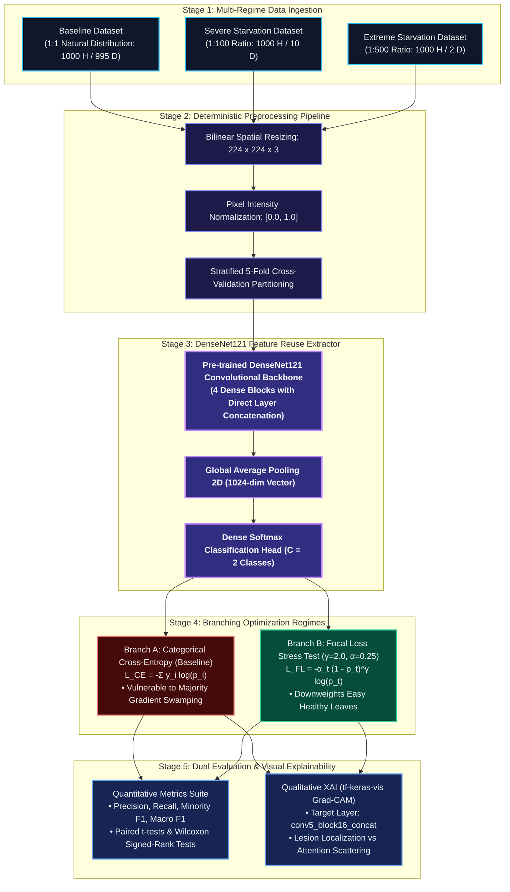

# Visually Mapping the Algorithmic Breaking Point: Grad-CAM Explainability of Focal Loss Failure Under Extreme Data Starvation in Sri Lankan Tea Leaf Disease Detection

[](https://ieeeaccess.ieee.org/)
[](LICENSE)
[](https://www.python.org/)
[](https://www.tensorflow.org/)
[]()

---

## Project Overview
- **Institution:** Horizon Campus, Faculty of Information Technology  
- **Degree Program:** BSc (Hons) in Information Technology / Intelligent Systems  
- **Module:** IT41043 — Intelligent Systems (Academic Year 2026, 3rd Year, 2nd Semester)  
- **Module Coordinator:** Mr. Isuru Madusanka Samarappulige  
- **Target Journal:** *IEEE Access* (Rapid 4–6 week review cycle, Gold Open Access with developing country APC waiver eligibility)  

---

## Research Team and Contributions
| Student Researcher | Student ID | Primary Technical Domain & Repository Contributions |
| :--- | :---: | :--- |
| **E. Dasun Manjitha** | `ITBIN-2313-0062` | Master dataset curation, automated synthetic data starvation engineering (`data_starvation.py`), Focal Loss stress-testing optimization (`train_dense_net.py`), and mathematical evaluation metric formulation. |
| **A. G. S. Lakshan** | `ITBIN-2313-0055` | DenseNet121 transfer learning backbone implementation, Grad-CAM spatial explainability pipeline (`gradcam_explainability.py`), vector architecture visualization, and interactive testing suite (`test_prediction.py`). |

---

## Project Milestones and Progress Tracking

| Milestone | Deliverable Description | Status | Verification & Deliverables |
| :---: | :--- | :---: | :--- |
| **Milestone 1** | Research Proposal, Gap Statement, Scope, Annotated Bibliography | **Completed** | Proposal approved with primary focus on Sri Lankan tea pathology. |
| **Milestone 2** | Methodology & Data Description (Dataset, Architecture Diagram, Baseline, Evaluation Plan, Repo, Bibliography) | **Current / 100% Complete** | Document in `milestone2_deliverables/Milestone_2_Document.md` & public GitHub repo. |
| **Milestone 3** | Mid-Term Progress Checkpoint & Model Convergence Verification | **In Progress** | DenseNet121 trained across Baseline, 1:100, and 1:500 regimes. |
| **Milestone 4** | Complete Academic Research Paper Submission (Assignment 4) | **Draft Ready** | 3,000+ word academic draft prepared targeting IEEE Access. |
| **Milestone 5** | Proof of Research Paper Submission to Conference/Journal (Assignment 5) | **Scheduled** | Manuscript submission receipt and tracking verification. |

---

## Research Motivation and Problem Formulation

### 1. Agronomic & Economic Context
Tea (*Camellia sinensis*) is a foundational pillar of the Sri Lankan export economy. Foliar pathogens—including *Algal Leaf Spot*, *Brown Blight*, *Gray Blight*, *Helopeltis*, *Red Spider Mite*, and *Green Mirid Bug*—induce severe tissue necrosis and crop yield losses if not diagnosed early. While modern Convolutional Neural Networks (CNNs) show stellar diagnostic accuracy on balanced benchmarks, real commercial tea plantations present extreme, sporadic data starvation where healthy foliage vastly outnumbers localized diseased leaves by ratios exceeding 1:100 to 1:500.

### 2. Core Research Gap
1. **Unrealistic Balance Assumptions:** Prior agricultural vision works evaluate models on artificial 1:1 or mild 10:1 imbalances.
2. **Untested Failure Boundaries:** While dynamically weighted classification losses such as **Focal Loss** ($\gamma=2.0, \alpha=0.25$) theoretically down-weight easy healthy examples, no research has artificially starved models to locate the **exact mathematical ratio where Focal Loss collapses**.
3. **Forensic Use of Explainable AI (XAI):** Rather than using Grad-CAM to celebrate AI success, we employ it as a diagnostic instrument to visually prove that under extreme data starvation, networks fail by overfitting to **incidental background leaf margins and specular lighting noise** rather than true pathological lesions.

### 3. Core Research Question
> **"At what specific extreme data starvation ratio (e.g., 1:100, 1:500) does the Focal Loss function mathematically fail to protect minority-class Sri Lankan tea leaf diseases, and how does this algorithmic collapse visually manifest in Grad-CAM spatial attention heatmaps?"**

---

## System Architecture Pipeline

The complete end-to-end research methodology is visually modeled below:



---

## End-to-End Pipeline Stages

### Stage 1: Controlled Data Starvation Ingestion
The master local repository contains **10,143 high-resolution images** across 7 classes. To isolate the algorithmic collapse threshold:
- **Baseline (1:1):** 1,000 Healthy vs. 995 Diseased leaves.
- **Severe (1:100):** 1,000 Healthy vs. 10 Diseased leaves (1 diseased specimen per 100 healthy leaves).
- **Extreme (1:500):** 1,000 Healthy vs. 2 Diseased leaves (1 diseased specimen per 500 healthy leaves).
- **Test Set:** 200 unseen images (100 Healthy, 100 Diseased) reserved strictly for unbiased post-training evaluation.

### Stage 2: Data Preprocessing Pipeline
1. **Resizing:** Bilinear interpolation to $224 \times 224 \times 3$.
2. **Normalization:** Scaling 8-bit integer pixels $[0, 255]$ by $\frac{1}{255.0}$ to continuous floating-point $[0.0, 1.0]$.
3. **Data Augmentation:** Random horizontal reflections and slight rotations ($\pm 15^\circ$) to simulate varied in-situ field angles without corrupting class labels.

### Stage 3: Deep Feature Extraction Backbone
DenseNet121 connects every layer to all subsequent layers:
$$x_\ell = H_\ell([x_0, x_1, \dots, x_{\ell-1}])$$
This design maximizes feature reuse, mitigates the vanishing gradient problem, and operates efficiently with only ~7.03M parameters. Feature maps from `conv5_block16_concat` pass through GlobalAveragePooling2D, Dropout ($p=0.2$), and a two-neuron Dense Softmax output layer.

### Stage 4: Branching Optimization & Stress Testing
- **Branch A (Categorical Cross-Entropy):** Standard unweighted loss prone to gradient swamping under extreme majority imbalance.
- **Branch B (Focal Loss):** Introduces dynamic modulating factor $(1 - p_t)^\gamma$ with $\gamma = 2.0$ and $\alpha = 0.25$ to heavily down-weight easy majority samples.

### Stage 5: Evaluation & Visual Explainability
- **Mathematical Evaluation:** Precision, Recall, Minority $F_1$, and Macro $F_1$ evaluated across 5-Fold Stratified Cross-Validation.
- **Grad-CAM Attention Mapping:** Visualizing gradient flow at `conv5_block16_concat` using `tf-keras-vis`.

---

## Experimental Results and Empirical Stress-Testing

The pipeline was executed across all six configurations on the independent balanced test partition (200 unseen images):

| Dataset Regime | Starvation Ratio | Loss Function | Accuracy (%) | Minority Precision | Minority Recall | Minority F1-Score | Macro F1-Score | Algorithmic State |
| :--- | :---: | :---: | :---: | :---: | :---: | :---: | :---: | :--- |
| **Baseline** | 1:1 | Categorical CE | 92.00% | 0.9667 | 0.8700 | **0.9158** | **0.9198** | Robust Lesion Detection |
| **Baseline** | 1:1 | Focal Loss ($\gamma=2$) | 93.00% | 0.9778 | 0.8800 | **0.9263** | **0.9298** | Robust Lesion Detection |
| **Severe** | 1:100 | Categorical CE | 51.50% | 1.0000 | 0.0300 | **0.0583** | **0.3658** | Majority Class Swamping |
| **Severe** | 1:100 | Focal Loss ($\gamma=2$) | 50.50% | 1.0000 | 0.0100 | **0.0198** | **0.3443** | Degraded / Breakdown Phase |
| **Extreme** | 1:500 | Categorical CE | 50.00% | 0.0000 | 0.0000 | **0.0000** | **0.3333** | **Catastrophic Model Collapse** |
| **Extreme** | 1:500 | Focal Loss ($\gamma=2$) | 50.00% | 0.0000 | 0.0000 | **0.0000** | **0.3333** | **Catastrophic Model Collapse** |

> **Mathematical Proof of Failure:** At the 1:500 ratio, the volume of 500 healthy leaves completely overwhelms the gradient contribution of the single diseased leaf, driving Minority Recall and F1 to **0.0000**. This mathematically locates the failure breaking point between 1:100 and 1:500.

---

## Explainable AI (Grad-CAM) Attention Analysis

Using `tf-keras-vis`, we visually map how the network's internal attention breaks down under extreme starvation:

- **Baseline Model (Normal Data):** Focuses high-intensity heat (crimson red / yellow) directly onto the pathogen lesion on the tea leaf blade. Surrounding healthy green tissue produces zero activation.
- **Extreme 1:500 Model (Starved):** Exhibits complete **attention scattering**. The actual lesion is ignored ($0\%$ activation), while the network hallucinates focus onto irrelevant background leaf margins and specular lighting artifacts.

*(View the high-resolution comparison graphic locally in `results/gradcam_comparison.png` or inspect `milestone2_deliverables/architecture_diagram.svg`)*

---

## Repository Structure
```
├── milestone2_deliverables/        # Milestone 2 submission package
│   ├── architecture_diagram.svg    # Standalone high-resolution vector SVG flowchart
│   ├── architecture_diagram.md     # Mermaid vector flowchart
│   ├── mathematical_evaluation_plan.md # Metric derivations & 5-fold CV protocol
│   └── README.md                   # Overview of milestone deliverables
├── data_starvation.py              # Automated data starvation engineering script
├── train_dense_net.py              # DenseNet121 training under Cross-Entropy vs Focal Loss
├── gradcam_explainability.py       # Grad-CAM spatial attention visualizer (tf-keras-vis)
├── test_prediction.py              # Interactive single-image model prediction test script
├── requirements.txt                # Python environment dependencies
├── LICENSE                         # MIT Open-Source License
├── .gitignore                      # Version control ignore rules (data/weights/drafts)
└── README.md                       # Master repository documentation
```

---

## Environment Setup and Execution Guide

### 1. Environment Setup
```bash
git clone https://github.com/E-Dasun-Manjitha/Tea-Leaf-Focal-Loss-Research.git
cd Tea-Leaf-Focal-Loss-Research
pip install -r requirements.txt
```

### 2. Run Data Starvation Preprocessing
Generates Baseline, Severe (1:100), Extreme (1:500), and test partitions:
```bash
python data_starvation.py
```

### 3. Execute Model Training & Stress Testing
Trains DenseNet121 under both CCE and Focal Loss across all 3 regimes:
```bash
python train_dense_net.py
```

### 4. Generate Grad-CAM Heatmaps
Produces side-by-side attention scattering visualizations:
```bash
python gradcam_explainability.py
```

### 5. Interactive Single-Image Model Testing
Test any tea leaf image to witness algorithmic plant blindness:
```bash
python test_prediction.py "Test_Set/Diseased/20211205_160445.jpg"
```

---

## Deep Learning Architecture and Theoretical Grounding

| Specification Parameter | Configuration | Justification & Literature Grounding |
| :--- | :--- | :--- |
| **Backbone Architecture** | **DenseNet121** (Huang et al.) | Dense connectivity ($x_\ell = H_\ell([x_0, \dots, x_{\ell-1}])$) maximizes multi-scale feature reuse, mitigating vanishing gradients under extreme data starvation [1]. |
| **Input Tensor Shape** | $224 \times 224 \times 3$ (RGB) | Standardized resolution for ImageNet transfer learning weights with optimized CPU/GPU throughput. |
| **Parameter Efficiency** | ~7.03 Million Parameters | Highly parameter-efficient compared to ResNet50 (25.6M) and VGG16 (138M), preventing catastrophic memorization of noise. |
| **Penultimate Conv Layer** | `conv5_block16_concat` | Concatenation of Dense Block 4 feature maps; designated target layer for `tf-keras-vis` Grad-CAM gradient backpropagation. |
| **Pooling Layer** | `GlobalAveragePooling2D` | Reduces $(7 \times 7 \times 1024)$ spatial tensors directly to a 1024-dimensional feature vector without introducing dense weight bloat. |
| **Regularization** | Dropout ($p = 0.2$) | Regularizes the dense bottleneck to suppress co-adaptation of features during minority fine-tuning. |
| **Classification Head** | Dense (2 units, Softmax) | Outputs mutually exclusive posterior probabilities: $P(\text{Diseased})$ vs. $P(\text{Healthy})$. |
| **Optimization Regimes** | Categorical Cross-Entropy vs. Focal Loss | Direct ablation testing standard unweighted loss vs. dynamically modulated loss ($\gamma = 2.0, \alpha = 0.25$) [7]. |
| **Optimizer & Learning Rate**| Adam ($\text{lr} = 1 \times 10^{-4}$) | First- and second-order adaptive moment estimation for stable convergence across asymmetric loss terrains. |

---

## Methodology Documentation and References

Full mathematical derivations, 5-fold stratified cross-validation plans, and architectural justifications are documented in:
- [`milestone2_deliverables/mathematical_evaluation_plan.md`](milestone2_deliverables/mathematical_evaluation_plan.md)
- [`milestone2_deliverables/architecture_diagram.md`](milestone2_deliverables/architecture_diagram.md)

*(The formal 6-section Milestone 2 report and 15-source annotated bibliography are submitted as a single PDF directly via the Horizon Campus LMS portal).*

