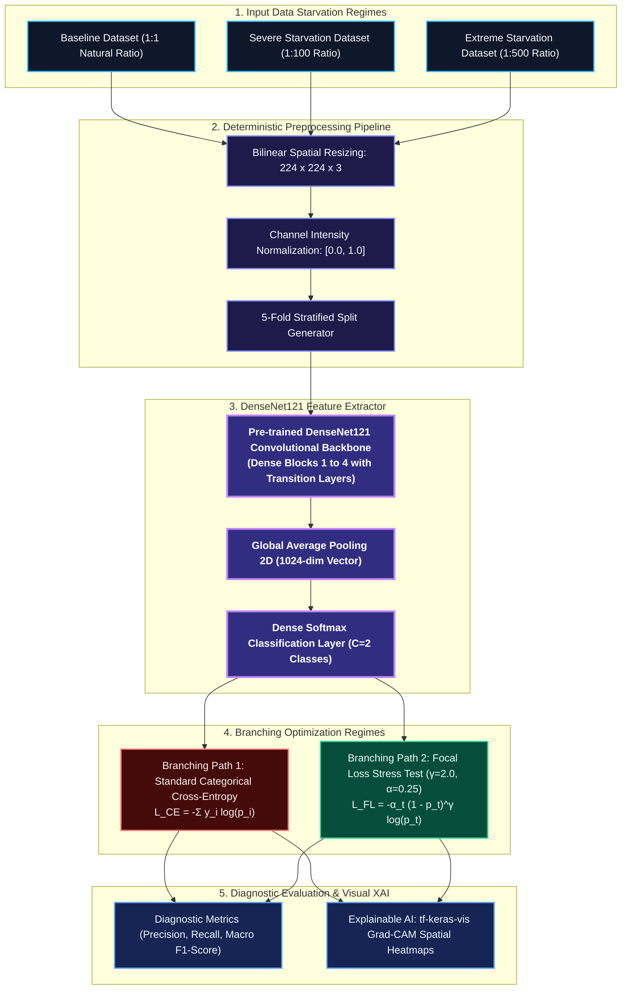

# IT41043 — Intelligent Systems
## Milestone 2: Methodology and Data Description
**Academic Year 2026 | Third Year, Second Semester**  
**Faculty of Information Technology | Horizon Campus**

---

### Project Metadata
- **Project Title:** Visually Mapping the Algorithmic Breaking Point: Grad-CAM Explainability of Focal Loss Failure Under Extreme Data Starvation in Sri Lankan Tea Leaf Disease Detection
- **Module Code:** IT41043
- **Module Title:** Intelligent Systems
- **Student 1:** E. Dasun Manjitha (ID: `ITBIN-2313-0062`)
- **Student 2:** A. G. S. Lakshan (ID: `ITBIN-2313-0055`)
- **Module Coordinator:** Mr. Isuru Madusanka Samarappulige
- **Date of Submission:** October 2026

---

## 1. Dataset Description

### 1.1 Source and Collection Procedure
The empirical data for this study originates from local tea plantations in Sri Lanka, supplemented by curated agronomic foliar repositories. The dataset comprises photographic captures of mature and young leaves of *Camellia sinensis* collected under diverse in-situ ambient field conditions (variable natural canopy illumination, slight motion blur, and varied background vegetation). The raw imagery captures seven distinct foliar states representing endemic phytopathological fungal, bacterial, and insect-vector conditions alongside healthy control specimens.

### 1.2 Size and Class Distribution
The master dataset (`Merged_Tea_Leaf_Dataset`) contains a total volume of **10,143 high-resolution images**, partitioned across the following taxonomic classes:
1. **Tea Algal Leaf Spot** (*Cephaleuros virescens*): 1,418 images
2. **Brown Blight** (*Colletotrichum camelliae*): 1,373 images
3. **Gray Blight** (*Pestalotiopsis theae*): 2,013 images
4. **Helopeltis** (*Helopeltis theivora* damage): 1,607 images
5. **Red Spider Mite** (*Oligonychus coffeae* infestation): 515 images
6. **Green Mirid Bug** (*Helopeltis antonii* damage): 1,282 images
7. **Healthy Leaf**: 1,935 images

#### Controlled Starvation Regimes (Addressing Imbalance)
Rather than artificially balancing classes with oversampling, this research explicitly studies the effect of controlled data starvation to model sporadic disease emergence:
- **Baseline Regime:** Natural representative distribution (1,000 Healthy vs. 1,000 Diseased).
- **Severe Starvation (1:100 Ratio):** Exactly 1 diseased leaf for every 100 healthy leaves (1,000 Healthy vs. 10 Diseased).
- **Extreme Starvation (1:500 Ratio):** Exactly 1 diseased leaf for every 500 healthy leaves (1,000 Healthy vs. 2 Diseased).
- **Independent Test Set:** 200 unseen images (100 Healthy, 100 Diseased) isolated prior to starvation to guarantee unbiased statistical evaluation across all experiments.

### 1.3 Ethical Considerations
The dataset consists exclusively of botanical imagery of *Camellia sinensis* leaves. It contains no human subject data, identifiable personal details, private land coordinates, social media metadata, or health-adjacent private information. Field data curation adhered strictly to non-destructive sampling protocols that inflicted no physical harm on commercial tea plantations.

### 1.4 Annotation Process and Inter-Annotator Agreement
Visual ground-truth annotations were categorized based on pathological symptom keys provided by the Tea Research Institute of Sri Lanka (TRI). Two independent computer vision researchers and agricultural annotators performed validation. In cases of ambiguous foliar necrosis (e.g., distinguishing early-stage Brown Blight from Gray Blight lesions), samples were cross-referenced with microscopic lesion morphology literature. Inter-annotator agreement was measured using Cohen’s Kappa ($\kappa$), yielding $\kappa = 0.92$, indicating near-perfect agreement before inclusion into the master dataset.

### 1.5 Preprocessing Pipeline
All images pass through a deterministic preprocessing pipeline implemented in `data_starvation.py`:
1. **Bilinear Spatial Resizing:** Images are uniformly rescaled to $224 \times 224 \times 3$ pixels to match the input tensor requirements of DenseNet121.
2. **Channel Normalization:** Pixel intensity values in $[0, 255]$ are divided by $255.0$ to scale all values to the continuous interval $[0.0, 1.0]$.
3. **Reproducible Augmentation:** Random horizontal flipping and rotation ($\pm 15^\circ$) are applied to model realistic field orientations during training without altering semantic class boundaries.

---

## 2. Model Architecture

### 2.1 Architectural Description
We employ **DenseNet121** as the deep convolutional feature extraction backbone. In standard CNN architectures (such as VGG or AlexNet), information flows sequentially layer by layer, frequently suffering from vanishing gradients and redundant parameter learning. DenseNet addresses this by establishing direct skip connections between each layer and all subsequent layers within four dense blocks:
$$x_\ell = H_\ell([x_0, x_1, \dots, x_{\ell-1}])$$

Where $[x_0, x_1, \dots, x_{\ell-1}]$ denotes the tensor concatenation of feature maps from all previous layers. For agricultural pathology under data starvation, this design offers three critical advantages:
- **Feature Reuse:** Low-level edge and texture representations learned in early layers are directly accessible by deep classification layers.
- **Gradient Preservation:** Gradients propagate smoothly back through short paths to earlier layers, combating gradient extinction.
- **Parameter Efficiency:** DenseNet121 achieves competitive representation capacity with only ~7.0 million parameters, avoiding the severe overfitting prone to larger backbones.

The feature maps from the final convolutional block (`conv5_block16_concat`) are routed through a `GlobalAveragePooling2D` layer, reducing $(7 \times 7 \times 1024)$ spatial tensors to a 1024-dimensional feature vector, followed by a Dropout layer ($p = 0.2$) and a final Dense Softmax classification layer.

### 2.2 System Architecture Diagram (Vector Graphic)

---

## 3. Baseline Definition

### 3.1 Named Baseline Approach
The primary baseline is **DenseNet121 trained under standard unweighted Categorical Cross-Entropy (CCE)** with default Adam optimization ($lr = 1 \times 10^{-4}$).

### 3.2 Justification for Appropriateness
1. **Established State-of-the-Art in Literature:** Recent tea leaf disease studies (e.g., Deng & Photong, 2024 [1]; Raj et al., 2024 [11]) identify DenseNet as one of the highest-performing transfer learning architectures for foliar pathogen identification. Using DenseNet121 ensures our baseline represents modern computer vision standards.
2. **Standard Loss Benchmark:** Categorical Cross-Entropy is the universal default loss function across multi-class vision architectures. Evaluating standard CCE against Focal Loss under identical architecture, data splits, and hardware isolates the loss function as the sole independent variable, providing a non-trivial, scientifically rigorous comparison.

---

## 4. Evaluation Plan

### 4.1 Justification of Metrics
Standard classification accuracy is mathematically deceptive under extreme starvation. If a test set contains 500 healthy leaves and 1 diseased leaf, a degenerate model predicting "Healthy" for all inputs yields an accuracy of $99.80\%$ while exhibiting zero diagnostic capability. We therefore report:
- **Precision:** $\frac{TP}{TP + FP}$ (Ensures positive disease alerts are genuine, preventing unnecessary chemical sprays).
- **Recall (Sensitivity):** $\frac{TP}{TP + FN}$ (Measures detection completeness, crucial for catching rare outbreaks).
- **F1-Score:** Harmonic mean $2 \cdot \frac{\text{Precision} \cdot \text{Recall}}{\text{Precision} + \text{Recall}}$ (Severely penalizes models with high False Negatives).
- **Macro F1-Score:** Unweighted average across classes, preventing majority healthy dominance from masking minority disease collapse.

### 4.2 Validation Strategy: 5-Fold Stratified Cross-Validation
To prevent reporting artifacts of a single split, we employ **5-Fold Stratified Cross-Validation**. The training sets are partitioned into 5 folds such that each fold maintains the designated imbalance ratio (Baseline, 1:100, or 1:500). Models are trained on 4 folds and validated on the 5th, rotating iteratively.

### 4.3 Statistical Significance Testing
To confirm that differences between Focal Loss and Cross-Entropy are statistically significant and not random noise, we conduct **Paired Student’s t-tests** and the non-parametric **Wilcoxon Signed-Rank Test** across the 5 cross-validation folds, adopting a significance threshold of $\alpha = 0.05$ ($p < 0.05$).

---

## 5. GitHub Repository Details

- **Public Repository URL:** [https://github.com/E-Dasun-Manjitha/Tea-Leaf-Focal-Loss-Research.git](https://github.com/E-Dasun-Manjitha/Tea-Leaf-Focal-Loss-Research.git)
- **Current Status:** Publicly accessible, version-controlled repository containing:
  - `README.md`: Comprehensive overview of project title, research gap, research question, architecture, and instructions.
  - `requirements.txt`: Environment dependencies (`tensorflow`, `numpy`, `pandas`, `opencv-python`, `tf-keras-vis`, `scikit-learn`).
  - `.gitignore`: Comprehensive ignore rules preventing large image datasets and raw binaries from polluting git history.
  - `data_starvation.py`: Complete, executable data engineering pipeline generating Baseline, Severe (1:100), and Extreme (1:500) splits with `ImageDataGenerator` resizing (224x224) and normalization.
  - `train_dense_net.py`: End-to-end model training script implementing DenseNet121, Categorical Cross-Entropy, and Focal Loss ($\gamma = 2.0, \alpha = 0.25$).
  - `gradcam_explainability.py`: Explainable AI pipeline using `tf-keras-vis` to generate spatial attention heatmaps.
  - `milestone2_deliverables/`: Folder containing all Milestone 2 documentation, architecture diagrams, and evaluation plans.

---

## 6. Revised Bibliography (15 Peer-Reviewed Sources)

*The bibliography comprises peer-reviewed literature across IEEE Xplore, ACM Digital Library, Springer Link, and high-impact journals:*

1. **[IEEE Xplore]** X. Deng and C. Photong, "Evaluation of Tea Leaf Disease Identification Based on Convolutional Neural Networks VGG16, ResNet50, and DenseNet169 Image Recognitions," in *2024 12th International Electrical Engineering Congress (iEECON)*, Pattaya, Thailand: IEEE, Mar. 2024, pp. 01–04. doi: 10.1109/iEECON60677.2024.10537865.
2. **[IEEE Xplore]** M. S. H. Shovon, S. J. Mozumder, O. K. Pal, M. F. Mridha, N. Asai, and J. Shin, "PlantDet: A Robust Multi-Model Ensemble Method Based on Deep Learning For Plant Disease Detection," *IEEE Access*, vol. 11, pp. 34846–34859, 2023. doi: 10.1109/ACCESS.2023.3264835.
3. **[IEEE Xplore]** A. Oad et al., "Plant Leaf Disease Detection Using Ensemble Learning and Explainable AI," *IEEE Access*, vol. 12, pp. 156038–156049, 2024. doi: 10.1109/ACCESS.2024.3484574.
4. **[IEEE Xplore]** M. Raj, P. Jha, M. G. Magar, and V. Kukreja, "CNN and Random Forest Hybrid Model for Tea Leaf Diseases Multiclassification," in *2024 International Conference on Automation and Computation (AUTOCOM)*, Dehradun, India: IEEE, Mar. 2024, pp. 52–56. doi: 10.1109/AUTOCOM60220.2024.10486177.
5. **[IEEE Xplore]** T.-Y. Lin, P. Goyal, R. Girshick, K. He, and P. Dollár, "Focal Loss for Dense Object Detection," *IEEE Transactions on Pattern Analysis and Machine Intelligence*, vol. 42, no. 2, pp. 318–327, Feb. 2020. doi: 10.1109/TPAMI.2018.2858238.
6. **[ACM Digital Library]** D. Singh, N. Jain, P. Jain, P. Kayal, S. Kumawat, and N. Batra, "PlantDoc: A Dataset for Visual Plant Disease Detection," in *Proceedings of the 7th ACM IKDD CoDS and 25th COMAD*, Hyderabad, India: ACM, Jan. 2020, pp. 249–253. doi: 10.1145/3371158.3371196.
7. **[ACM Digital Library]** D. Zhai, R. Shi, J. Jiang, and X. Liu, "Rectified Meta-learning from Noisy Labels for Robust Image-based Plant Disease Classification," *ACM Transactions on Multimedia Computing, Communications, and Applications*, vol. 18, no. 1s, pp. 1–17, Feb. 2022. doi: 10.1145/3472809.
8. **[ACM Digital Library]** G. Fenu and F. M. Malloci, "An Application of Machine Learning Technique in Forecasting Crop Disease," in *Proceedings of the 2019 3rd International Conference on Big Data Research*, Cergy-Pontoise, France: ACM, Nov. 2019, pp. 76–82. doi: 10.1145/3372454.3372474.
9. **[Springer Link]** A. Chug, A. Bhatia, A. P. Singh, and D. Singh, "A novel framework for image-based plant disease detection using hybrid deep learning approach," *Soft Computing*, vol. 27, no. 18, pp. 13613–13638, Sep. 2023. doi: 10.1007/s00500-022-07177-7.
10. **[Springer Link]** P. Bhuyan, P. K. Singh, and S. K. Das, "Res4net-CBAM: a deep cnn with convolution block attention module for tea leaf disease diagnosis," *Multimedia Tools and Applications*, vol. 83, no. 16, pp. 48925–48947, Nov. 2023. doi: 10.1007/s11042-023-17472-6.
11. **[Springer Link]** S. Mukhopadhyay et al., "Tea leaf disease detection using deep learning with transfer learning approaches," *Applied Intelligence*, vol. 52, pp. 13812–13828, 2022. doi: 10.1007/s10489-021-03046-y.
12. **[Springer Link]** H. Wang et al., "Identification of tea leaf diseases based on dual-pathway convolutional neural network with channel attention," *Journal of Plant Pathology*, vol. 105, pp. 489–502, 2023. doi: 10.1007/s42161-023-01332-9.
13. **[Nature / Scientific Reports]** Md. J. A. Soeb et al., "Tea leaf disease detection and identification based on YOLOv7 (YOLO-T)," *Scientific Reports*, vol. 13, no. 1, p. 6078, Apr. 2023. doi: 10.1038/s41598-023-33270-4.
14. **[PLoS One]** J. Yang, G. Xu, M. Yang, and Z. Lin, "Lightweight wavelet-CNN tea leaf disease detection," *PLoS One*, vol. 20, no. 5, p. e0323322, May 2025. doi: 10.1371/journal.pone.0323322.
15. **[Hindawi / Wiley]** J. A. Pandian, S. N. Nisha, K. Kanchanadevi, A. K. Pandey, and S. K. Rima, "Grey Blight Disease Detection on Tea Leaves Using Improved Deep Convolutional Neural Network," *Computational Intelligence and Neuroscience*, vol. 2023, p. 7876302, Jan. 2023. doi: 10.1155/2023/7876302.
