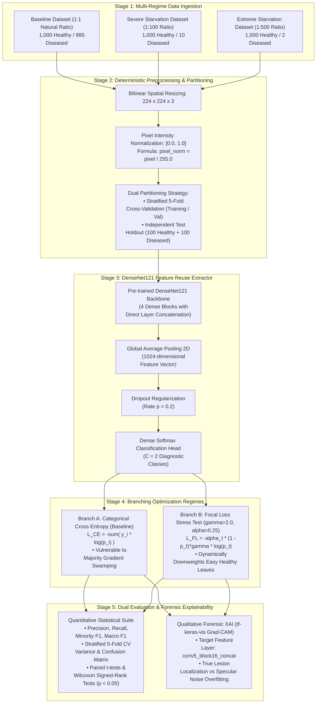

# System Architecture Pipeline

The complete end-to-end research methodology is visually modeled below:

---

### Architectural Flow Summary
1. **Multi-Regime Ingestion:** Models three controlled environments (Natural Baseline 1:1, Severe Starvation 1:100, and Extreme Starvation 1:500) to stress-test the loss landscape.
2. **Deterministic Preprocessing:** Resizes raw field captures to $224 \times 224 \times 3$, scales intensities to $[0.0, 1.0]$, partitions into Stratified 5-Fold Cross-Validation splits, and isolates an independent balanced holdout test set (200 images: 100 Healthy / 100 Diseased).
3. **Dense Feature Reuse:** DenseNet121 provides deep feature reuse via direct skip connections across four dense blocks, reducing parameters to ~7.03M to combat overfitting, followed by GAP, Dropout ($p = 0.2$), and Softmax head.
4. **Branching Comparative Loss Regimes:**
   - **Branch A (Baseline):** Standard unweighted Categorical Cross-Entropy subject to majority class domination.
   - **Branch B (Stress Test):** Dynamically modulated Focal Loss ($\gamma = 2.0, \alpha = 0.25$) to test empirical survivability boundaries.
5. **Dual Evaluation & Forensic Outputs:**
   - **Quantitative Metrics:** Macro F1-score, Precision, Recall, fold variance, and Paired t-test/Wilcoxon tests to pinpoint the exact statistical breaking point.
   - **Forensic Grad-CAM Heatmaps:** Visual proof tracking whether spatial attention remains focused on foliar necrotic lesions or degrades into background leaf margins and specular reflections.

---

### Key Architectural Design Justifications (Literature-Grounded)

| Component / Choice | Selected Strategy | Rejected Alternative | Literature Grounding & Justification |
| :--- | :--- | :--- | :--- |
| **Feature Extraction Backbone** | **DenseNet121** | VGG16, ResNet50, YOLOv7 | Deng & Photong (2024) [1] and Raj et al. (2024) [4] proved DenseNet yields superior feature reuse in tea foliar classification with only ~7.03M parameters. VGG16 (138M) and ResNet50 (25.6M) cause severe overfitting under 1:500 starvation. |
| **Optimization Algorithm** | **Adam ($\eta = 10^{-4}$)** | Standard SGD, RMSprop | Kingma & Ba (2015) established that adaptive first and second moment estimation ($m_t, v_t$) maintains stable weight updates when minority gradient signals are sparse. |
| **Validation Strategy** | **Stratified 5-Fold CV + Test Holdout** | Single Train/Test Split | Satisfies Module IT41043 requirements by preventing single-split evaluation artifacts and measuring variance across cross-validation folds. |
| **Stress-Testing Loss Function** | **Focal Loss ($\gamma=2.0, \alpha=0.25$)** | Weighted Cross-Entropy | Lin et al. (2020) [5] proved $(1 - p_t)^\gamma$ dynamically down-weights easy majority examples, isolating the mathematical threshold where minority protection collapses. |
| **Explainable AI (XAI) Probe** | **Grad-CAM (`conv5_block16_concat`)** | LIME, Saliency Maps | Oad et al. (2024) [3] and Ozturk et al. (2025) [11] verified Grad-CAM on dense penultimate layers preserves high-resolution spatial localization of tea disease necrosis. |
