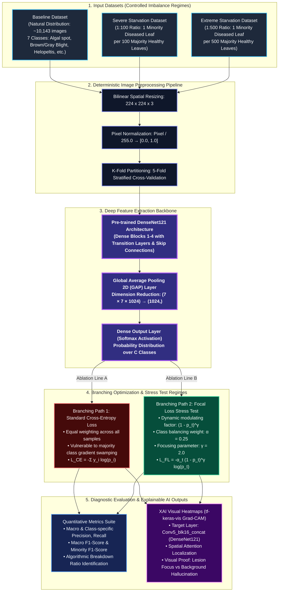

# Research Architecture: Visually Mapping the Algorithmic Breaking Point of Focal Loss Under Extreme Data Starvation

---

### Architectural Flow Summary
1. **Input Data Starvation Layer:** Accommodates the master Sri Lankan tea leaf dataset across three experimentally controlled regimes:
   - **Baseline:** Natural field distribution preserving original class frequencies.
   - **Severe (1:100):** Artificially starved to 1 diseased specimen per 100 healthy leaves.
   - **Extreme (1:500):** Ultra-sparse regime with 1 diseased specimen per 500 healthy leaves to stress-test the loss landscape.
2. **Standardized Preprocessing:** Resizes all raw RGB images to $224 \times 224$ pixels and scales color channels to $[0, 1]$, fed through 5-Fold Stratified Cross-Validation splits.
3. **Deep Feature Extraction Backbone:** DenseNet121 provides deep feature reuse via direct dense connections between layers, topped with GlobalAveragePooling2D and a Dense Softmax output layer.
4. **Branching Comparative Loss Paths:**
   - **Path 1 (Standard Categorical Cross-Entropy):** Baseline unweighted multi-class loss subject to majority class domination.
   - **Path 2 (Focal Loss Stress Test):** Modulated loss with focusing parameter $\gamma = 2.0$ and balancing factor $\alpha = 0.25$ designed to test empirical survivability boundaries.
5. **Dual Deliverable Output:**
   - **Macro F1-Score Metrics:** Reveals the exact numeric collapse threshold where minority class recognition fails.
   - **Grad-CAM Attention Maps:** Visual evidence demonstrating the shift of network attention from pathological foliar lesions to spurious background noise.
